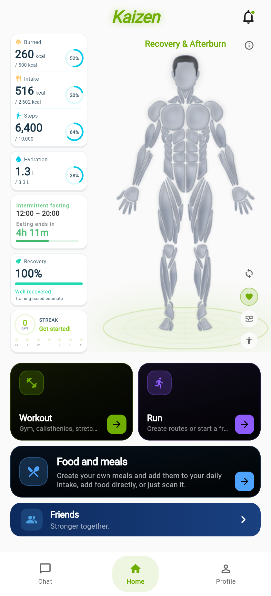
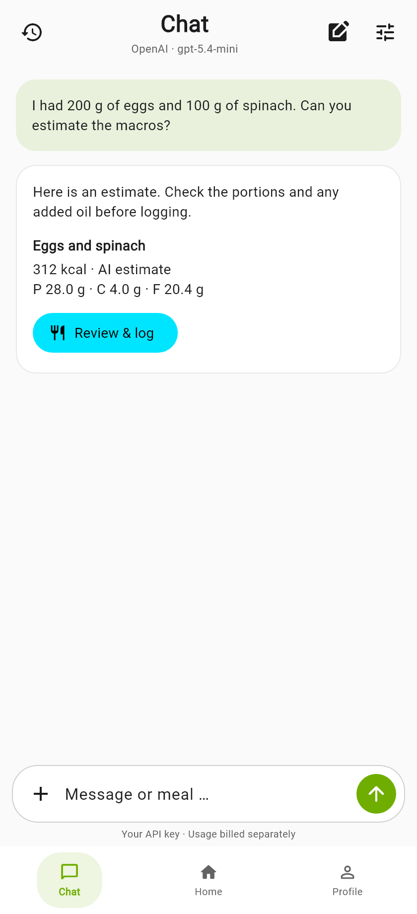
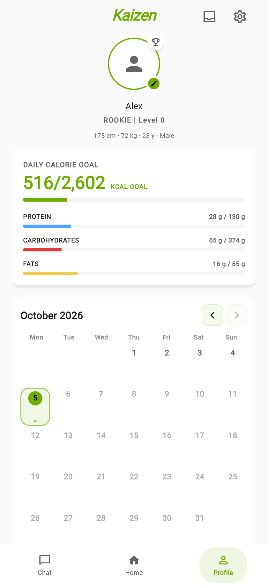

# Jan Kilic

Informatik (M.Sc.) an der RWTH Aachen · Softwareentwicklung und Softwareprojektmanagement. Ich suche eine Vollzeitstelle und interessiere mich für Software Engineering, IT-Consulting und Produktmanagement.

## Kaizen · Fitness-App mit Flutter

Mit Kaizen plane ich mein Training, protokolliere Mahlzeiten und verfolge meinen Fortschritt. Das Tagebuch speichert Einträge mit Hive auf dem Gerät und funktioniert auch im Fitnessstudio ohne Empfang. Für gemeinsam genutzte Funktionen wie das Teilen eines Laufs kommt Firebase zum Einsatz.

| Tagesübersicht | Mahlzeit prüfen | Fortschritt |
| --- | --- | --- |
|  |  |  |

Wie wird aus einem KI-Vorschlag ein Tagebucheintrag, und warum zählt eine Mahlzeit auch nach zweimaligem Tippen nur einmal? [Architektur und Designentscheidungen](projects/kaizen/README.md) · [Quellcode und Startanleitung](https://github.com/JanErcanK/Kaizen) · [Automatische Tests](https://github.com/JanErcanK/Kaizen/actions/workflows/verify.yml)

## Weitere Projekte

| Projekt | Was ich entwickelt habe |
| --- | --- |
| [Morgenroutine · Morgenraum](https://github.com/JanErcanK/morgenraum) | Eine geführte Morgenroutine für Android und Windows mit sechs anpassbaren Übungen, deutscher Sprachführung und Kameraspiegel. |
| [NoteMe](https://github.com/JanErcanK/NoteMe) | Ein Tipp auf einen kleinen Bären am Bildschirmrand öffnet eine Notiz über der aktuellen Android-App. Die Einträge lassen sich schreiben oder diktieren und werden lokal in SQLite gespeichert. |
| [Shorts Organizer · Clipfolio](https://github.com/JanErcanK/VideoOrganizer) | Videolinks aus dem Teilen-Menü sammeln und später anhand von Tags, Kommentaren und Laufzeit wiederfinden. |
| [Hauskern](https://github.com/JanErcanK/Hauskern) | Ein interaktiver Smart-Building-Prototyp mit Gebäudemodell und Ansichten für die Ontologien Brick und RealEstateCore. |
| [Ortho](https://github.com/JanErcanK/Ortho) | Ein Flutter-Prototyp für die orthopädische Versorgung mit eigenen Ansichten für Kundschaft, Mitarbeitende und Werkstatt. |

Neben Flutter und Dart arbeite ich mit Python, Java und JavaScript/TypeScript. Aus dem Softwareprojektmanagement bringe ich Erfahrung mit agiler Entwicklung, Scrum und Projektplanung mit.

[LinkedIn](https://www.linkedin.com/in/jan-kilic/) · [E-Mail](mailto:jan.kilic@rwth-aachen.de)
