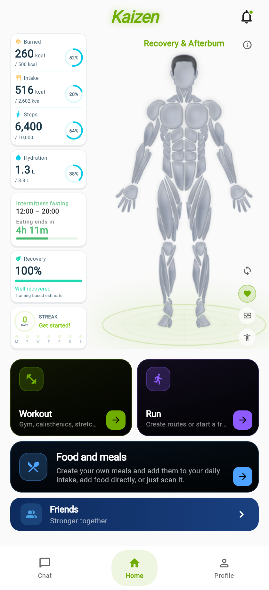
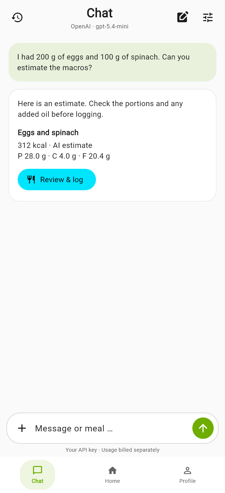
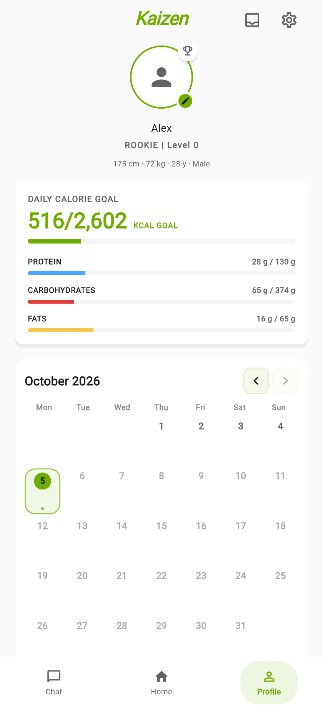

# FitFlow · die Fitness-App Kaizen

Kaizen bündelt Trainingsplanung, Mahlzeiten und Fortschritt in einer Flutter-App. Der ursprüngliche Projektname ist **FitFlow**. Wer nach dem Training sein Essen einträgt, kann das Tagebuch ohne Netz verwenden. Erst Funktionen wie die KI-Schätzung einer Mahlzeit oder das Teilen eines Laufs benötigen einen externen Dienst.

| Tagesübersicht | Mahlzeit prüfen | Fortschritt |
| --- | --- | --- |
|  |  |  |

Die drei Ansichten stammen aus den Flutter-Widgets der App. Sie zeigen synthetische Beispieldaten und eine vorbereitete Coach-Antwort.

## Warum Flutter?

Die Trainingsansichten, die Ernährungslogik und das Datenmodell lassen sich in Dart gemeinsam pflegen. Für die Körperansicht ist das besonders praktisch. Ein eigener Painter zeichnet die Muskelgrafik, während normale Flutter-Widgets die Tageswerte und Bedienelemente darstellen. Dieselben Widgets lassen sich mit einem festen Beispieltagebuch im Test rendern. So sind die Screenshots reproduzierbar.

Plattformspezifischer Code bleibt dort nötig, wo das Betriebssystem beteiligt ist. Beispielsweise nimmt der Android-Host einen geteilten Inhalt entgegen und reicht ihn an den Coach weiter. Das iOS-Projekt besitzt eigene Berechtigungen für Gesundheitsdaten. Ein erfolgreicher Widget-Test ersetzt hier keinen Gerätetest.

## Warum Hive für das Tagebuch und Firebase für Freunde?

| Anwendungsfall | Entscheidung und Konsequenz |
| --- | --- |
| Nach dem Training einen Satz oder eine Mahlzeit eintragen | Die App schreibt in eine lokale Hive-Datenbank. Der Eintrag ist ohne Konto und Netzwerk verfügbar. Für das persönliche Tagebuch gibt es dadurch keinen automatischen Abgleich mit einem zweiten Gerät. |
| Einen Lauf mit einem Freund teilen | Beide Geräte brauchen einen gemeinsamen Datenstand. Für diesen Teil verwendet die App Firebase Authentication und Cloud Firestore über REST. Eine angenommene Freundschaft und die Freigabe für den jeweiligen Lauf steuern den Zugriff. |
| Eine Mahlzeit vom KI-Coach schätzen lassen | Der konfigurierte Anbieter erhält die Anfrage. Sein Ergebnis ist ein Vorschlag. Erst nach der Prüfung werden die Portionen ins lokale Ernährungstagebuch übernommen. |

## Vom Vorschlag zum Tagebucheintrag

1. Der Coach liefert eine strukturierte Mahlzeit mit Zutaten, Mengen und Nährwerten. Der Parser prüft die Felder, bevor die Oberfläche den Vorschlag anbietet.
2. Im Prüfdialog kann der Nutzer die Portionen korrigieren. Beim Bestätigen übergibt der Dialog den Entwurf und die ID der Chatnachricht an `ProgressStore.confirmChatMeal`.
3. Der Store schreibt die Portionen und einen Vermerk mit dieser ID in einem gemeinsamen Hive-Aufruf. Ein zweiter Tap während des Schreibens wird abgefangen. Nach einem Neustart erkennt die App die bereits gespeicherte Mahlzeit am Vermerk.
4. Erst nach dem Schreiben benachrichtigt der Store die Oberfläche. Der Tageswert enthält die bestätigten Portionen genau einmal.

Der zugehörige Dart-Test startet zwei Bestätigungen für dieselbe Nachricht gleichzeitig. Anschließend öffnet er die Datenbank erneut und bestätigt den Vorschlag an einem anderen Datum. Er prüft, dass die zwei Zutaten am ursprünglichen Tag stehen, ihre Nährwerte stimmen und am neuen Tag kein Eintrag entsteht.

## Eine Grenze der aktuellen Architektur

Der zentrale `ProgressStore` macht den Schreibpfad von der Oberfläche bis zur Datenbank leicht nachvollziehbar. Inzwischen verwaltet er auch Training, Ernährung und Einstellungen. Änderungen an einer Domäne berühren dadurch dieselbe Klasse. Ein sinnvoller nächster Schnitt wäre eine eigene Schnittstelle für das Ernährungstagebuch. Der Test für die doppelte Bestätigung beschreibt das Verhalten, das ein solcher Umbau erhalten muss.

[Datenschutzerklärung der App](https://janercank.github.io/kaizen-privacy_policy/) · [Zurück zum Profil](../../README.md)
